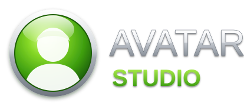

<p align="center">
  
</p>

<p align="center">
  Make, change and keep your Xbox 360 avatars on your PC, in the 2010 avatar editor's own look.
</p>

## Get it

1. Download **AvatarStudio.zip** from the [latest release](../../releases/latest).
2. Right-click the zip and choose **Extract All**.
3. Double-click **AvatarStudio.exe** in the folder that makes.

There is nothing else to install. The first start downloads about 200 MB and sets itself up in a few
minutes. If it stops, choose **Try Again** and it carries on.

If Windows says it protected your PC, choose **More info**, then **Run anyway**. The program is free,
so it isn't signed.

Needs 64-bit Windows 10 or 11. Use a controller, or a mouse and keyboard.

## What it does

- **Create** an avatar from a lineup of random starters, as on the console.
- **Edit** every feature, colour and item the 2010 editor had.
- **Keep** a library of your avatars.
- **Import** `.avatar` files, the console's `avatar.bin` and Xbox profiles.
- **Export** to `.avatar`, `avatar.bin` or a picture.
- **Play:** press X on an avatar's card to use it in your games.

## Controls

The buttons on screen change to keys as soon as you use the keyboard or mouse.

| | Controller | Keyboard | Mouse |
|---|---|---|---|
| Move | D-pad, left stick | Arrow keys | Point |
| Choose | A | Enter | Click |
| Back | B | Esc | Right-click |
| Turn the page | LB / RB | Page Up / Page Down | Wheel |
| Turn your avatar | LT / RT | Q / E | |
| The X and Y actions | X / Y | X / Y | Click them on screen |

## Your files

Avatar Studio contains no Microsoft files. Its first start downloads what it needs onto your own PC:
the Xbox 360 system update from the Internet Archive, an item table from Microsoft's avatar server,
and FFmpeg from GitHub, which converts the sounds once and is then deleted.

Nothing is uploaded. Everything stays in `%LOCALAPPDATA%\Avatar Studio`, with your avatars in its
`avatars` folder. PC ports of avatar games can read the one you chose from its `player` folder.

## Build from source

Only needed if you want to change the code. On Windows, with Python 3.9 or newer, git, and Visual
Studio 2022 (or its Build Tools) with **Desktop development with C++**:

```
python build/build.py
```

The result is in `dist/`.

## Credits

Avatar Studio by **LegendaryDoors**, under the MIT licence.

Built with [FNA](https://github.com/FNA-XNA/FNA), FNA3D, FAudio, MojoShader,
[SDL3](https://github.com/libsdl-org/SDL), FNA's LzxDecoder and
[XenosRecomp](https://github.com/hedge-dev/XenosRecomp) (ported to C# in `src/`). Each licence ships
in the zip's `licenses` folder.

A fan-made preservation project, not affiliated with or endorsed by Microsoft. Xbox, Xbox 360 and
Xbox LIVE are trademarks of Microsoft. No Microsoft software or content is included in this
repository or its releases.
